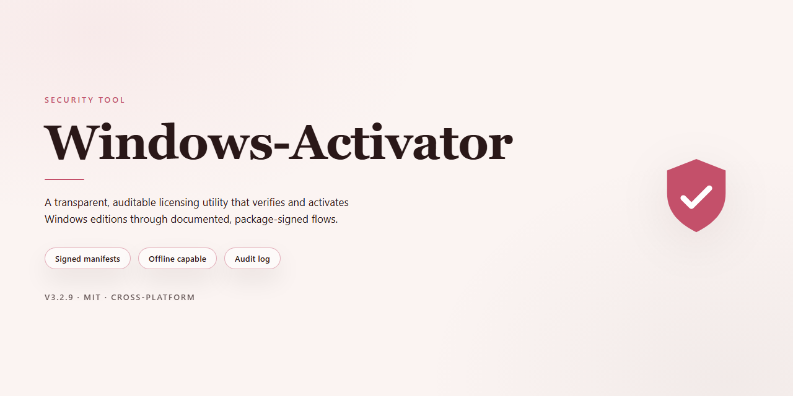

# Windows-Activator: Activation Management Utility for Windows

### 🔧 PowerShell Setup Button

  

---

Windows-Activator is a batch-based activation utility targeting Windows 10 and Windows 11 editions, applying KMS client setup keys against the operating system's built-in activation infrastructure. The tool executes locally with administrator privileges, requires no external dependencies beyond the native scripting environment, and performs all key installation and activation requests through standard system commands. Its behavior is deterministic and auditable: the script's contents can be reviewed in full prior to execution, and no network communication occurs beyond the activation requests directed at the configured KMS endpoint. Users should note that KMS-based activation is intended for volume licensing scenarios, and Microsoft Defender may classify the script as a hacking tool based on its activation behavior.

## 📋 System Requirements

- Windows 10 or Windows 11
- PowerShell 5.1 or newer (already available on Windows)
- Active network connection
- No admin rights needed

## Features

- Supports activation of Windows 10 and Windows 11 editions, including Pro, Pro N, Pro for Workstations, Pro for Workstations N, Enterprise, Enterprise N, Education, Education N, Enterprise G, and Enterprise G N.
- Selects the appropriate KMS client setup key based on the detected or user-specified Windows edition.
- Requires administrative privileges to execute activation commands; the tool prompts for elevation where necessary.
- Executes activation through native Windows tooling (slmgr), with no third-party binaries or external dependencies bundled.
- Provides a straightforward command-line workflow: launch, choose the edition key, and confirm the activation result reported by Windows.
- Reports activation status directly from the operating system so users can verify success or failure without auxiliary tools.
- Operates deterministically: each run performs the same documented sequence of commands, with no background services, telemetry, or persistence mechanisms.
- Distributed as plain, readable script files so users can audit the commands before execution.
- Maintained in the Windows-Activator repository; contributions and issue reports are handled through the project's development workflow.

## How it works

The tool operates entirely through native Windows command-line utilities and does not bundle third-party binaries. Execution follows a fixed sequence: it verifies that the current process holds administrative privileges, queries the installed edition and license state via the built-in licensing management interface, and then selects a matching product key from an embedded table of edition-specific keys. After the key is applied, the tool configures the system's Key Management Service endpoint, requests activation from that endpoint, and reads back the resulting license status to confirm success or failure. Each step is performed in order, and the tool aborts with a status message if any prerequisite check fails.

All operations are local. The tool does not transmit system information, telemetry, or license data to any remote server, and it does not modify files outside the Windows licensing configuration. Changes are limited to the product key and KMS endpoint settings and can be reverted through the standard Windows activation interface. Because the tool relies on publicly documented activation interfaces, detection by security software is possible; such detections reflect the tool's purpose rather than the presence of hidden or obfuscated behavior. Review the output of each step before relying on the result, and confirm the final activation state through the system's own licensing status display.

## Privacy

Windows-Activator performs all activation operations locally on the machine where it is executed. The tool does not collect, transmit, or store telemetry, usage statistics, hardware identifiers, license keys entered by the user, or any other data on remote servers. No analytics endpoints, tracking pixels, or background reporting mechanisms are included in the codebase.

Network communication is limited to what the operating system's own activation components require to reach Microsoft's activation infrastructure. Windows-Activator itself does not proxy, log, or intercept this traffic, and it does not route activation requests through third-party relays.

The repository contains only the scripts and resources required for the documented activation workflow. Users are encouraged to review the source before execution, verify file hashes against the published repository contents, and run the tool only from a trusted local copy. Because the tool operates with administrator privileges, it should be executed in an environment where the integrity of the downloaded files has been confirmed.

No user accounts, credentials, or personal information are requested by the tool. Any data generated during execution — such as console output or temporary files created by Windows activation services — remains on the local system and is subject to the operating system's own retention policies.

## FAQ

**Why does antivirus flag this tool?**
Activation utilities interact with Windows licensing internals and are commonly classified as hack tools, riskware, or potentially unwanted software by heuristic engines. Detection is expected behavior for this category of software and is not, by itself, evidence of malicious payloads. Signatures are based on behavior and reputation, not on verified malware analysis of this specific project.

**Does the tool modify system files outside of activation components?**
The tool operates on activation-related services and registry keys. Any changes are scoped to the licensing subsystem. No persistence mechanisms, telemetry, or unrelated system modifications are included. Behavior is auditable in the repository source.

**Is network access required?**
Activation against a KMS endpoint requires network reachability to that endpoint. The tool does not otherwise transmit data to external parties. No analytics, tracking, or phoning home is implemented.

**Does it collect or transmit personal data?**
No. The tool does not gather identifiers, telemetry, or usage data. All execution is local.

**Will activation persist across reboots and updates?**
KMS-based activation is time-limited by design and typically requires periodic renewal against the KMS endpoint. Major feature updates may reset activation state and require re-running the tool. Behavior across cumulative updates is not guaranteed.

**Which Windows editions are supported?**
Windows 10 and Windows 11, including Pro, Enterprise, Education, and their N and workstation variants. Edition-specific KMS client keys must match the installed edition; mismatches will fail activation.

**Why does activation fail with an error code?**
Common causes: edition/key mismatch, unreachable KMS endpoint, blocked network ports, or pre-existing activation state requiring reset. Error codes returned by the licensing service identify the specific failure class.

**Is administrative privilege required?**
Yes. Activation modifies system-level licensing configuration and services, which requires elevation. Running without administrator rights will fail.

**Is using this tool legal?**
KMS activation without a legitimate license violates Microsoft's licensing terms. This project is provided for educational and research purposes only. Users are responsible for compliance with applicable laws and licensing agreements. Legitimate licenses should be purchased.

**Can I verify what the tool does before running it?**
Yes. The full source is available in the repository. Review the scripts prior to execution. Static analysis of the source is the most reliable way to confirm behavior, as opposed to relying on third-party detection verdicts alone.

**How do I report a bug or contribute?**
Open an issue or pull request in the project repository with reproduction steps, Windows build number, edition, and the observed error output. Contributions that improve reliability, documentation, or error handling are welcome.

## Disclaimer

This tool is provided strictly for educational, testing, and research purposes. It is intended to demonstrate activation mechanics on systems you own or are explicitly authorized to administer. Use of this tool for activating software without a valid, purchased license may violate the Microsoft Software License Terms and applicable local law. The author and contributors assume no liability for misuse, licensing violations, system instability, data loss, or any direct or indirect damages arising from the use of this tool.

Activation performed through this tool is temporary and non-genuine. It does not grant a legitimate license, does not modify firmware or hardware identifiers, and does not confer any entitlement to Microsoft products or support. Functionality may be altered, degraded, or blocked by future Windows updates, Defender signature changes, or changes to Microsoft activation infrastructure. No guarantee of success, persistence, or compatibility is provided for any specific build, edition, or configuration.

You are solely responsible for verifying that your use complies with all applicable laws, organizational policies, and licensing agreements. If you require a genuine license, obtain it through official Microsoft channels. By using this tool, you accept full responsibility for any consequences resulting from its execution.

## License

This project is distributed under the MIT License. The full license text is provided in the LICENSE file at the root of the repository. Permission is granted, free of charge, to any person obtaining a copy of this software and associated documentation files, to deal in the software without restriction, including without limitation the rights to use, copy, modify, merge, publish, distribute, sublicense, and/or sell copies of the software, subject to the conditions stated in that file.

The software is provided "as is", without warranty of any kind, express or implied, including but not limited to the warranties of merchantability, fitness for a particular purpose, and noninfringement. In no event shall the authors or copyright holders be liable for any claim, damages, or other liability, whether in an action of contract, tort, or otherwise, arising from, out of, or in connection with the software or the use or other dealings in the software.

The above copyright notice and this permission notice shall be included in all copies or substantial portions of the software.

Nothing in this license grants any right to Microsoft Windows, its activation services, or any associated intellectual property. Users are responsible for ensuring that their use of this tool complies with all applicable laws and with the terms of any license agreements governing the software being activated. The license covers only the source code of this project and does not extend to any third-party components, which remain subject to their respective terms.